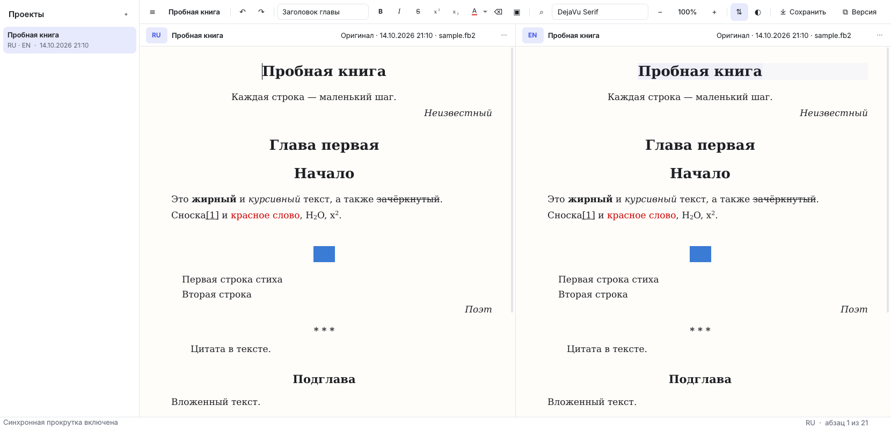

# FB2 Translation Editor

Приложение для Windows, в котором оригинал и перевод книги в формате FB2 открыты рядом. Их можно листать синхронно и править прямо в тексте, как в обычной читалке, без XML-разметки.



## Возможности

- **Синхронная прокрутка.** Книги выравниваются по главам, а внутри главы — по абзацам, если их число совпадает. Если не совпадает, глава сопоставляется пропорционально.
  Абзац, соответствующий тому, где стоит курсор, подсвечивается во второй книге.
  Ползунок между книгами прокручивает обе сразу и при перетаскивании показывает название главы.
  `Alt + колесо` прокручивает только одну книгу. `Ctrl+L` включает и выключает синхронизацию, `Ctrl+Shift+L` выравнивает книги сразу.
- **Текст как в читалке.** Заголовки, эпиграфы, стихи, цитаты, сноски и картинки показываются оформленными.
- **Общий размер текста** для обеих книг: кнопки `−` / `+`, `Ctrl +`, `Ctrl −`, `Ctrl + колесо`, `Ctrl+0` для сброса. Шрифт для чтения выбирается в панели.
- **Редактирование прямо в книге.** `Enter` создаёт новый абзац. Кнопки и горячие клавиши для жирного, курсива, зачёркнутого, индексов, цвета и стилей абзаца (заголовок главы, подзаголовок, эпиграф, цитата, стихи, подпись автора).
- **Вставка через `Ctrl+C` / `Ctrl+V`** текста (с жирным и курсивом), картинок из буфера обмена и файлов картинок. `Ctrl+Shift+V` вставляет без форматирования. Картинки сохраняются внутрь FB2.
- **Несколько проектов.** Список проектов слева. Приложение помнит последний открытый проект и место чтения в каждой книге.
- **Версии.**
  - Оригинал сохраняется при создании проекта и никогда не перезаписывается.
  - «Сохранить» (`Ctrl+S`) — быстрое сохранение: в первый раз добавляет версию «Быстрое сохранение», потом перезаписывает её.
  - «Версия» (`Ctrl+Shift+S`) — всегда добавляет новую версию с комментарием.
  - Версию для каждой книги можно выбрать в заголовке панели. В меню `⋯` можно открыть другой FB2-файл, экспортировать текущую версию в любую папку и удалить ненужную версию.
- **Сноски.** При наведении на ссылку сноски появляется её текст. Щелчок открывает окно сноски с кнопкой «Перейти к сноске», `Ctrl+щелчок` сразу переходит к ней, `Alt+←` возвращает обратно к тексту. `Ctrl+щелчок` по внешней ссылке открывает её в браузере.
- **Проверка орфографии** русского и английского текста (словари Hunspell из LibreOffice, встроены в программу). Ошибки подчёркиваются красной волной. Правый щелчок по слову показывает варианты исправления, а также пункты «Добавить в словарь» и «Пропустить везде». Включается и выключается клавишей `F7`. Слова, добавленные в словарь, хранятся в `user_words.txt`.
- **Номера абзацев и прогресс.** Слева у каждого абзаца стоит его номер (`Ctrl+Shift+N` — показать/скрыть). В заголовке книги видно, на каком абзаце вы читаете и сколько книги пройдено с точностью до десятой процента: `¶ 152 / 4810 · 3,2%`.
- **Двойной щелчок по абзацу** прокручивает вторую книгу к соответствующему абзацу, ставит его на ту же высоту и подсвечивает.
- **Поиск и замена** (`Ctrl+F`) в одной или в обеих книгах.
- Светлая и тёмная тема (`Ctrl+Shift+D`).

Описание книги (`description`), обложка, сноски, `id` разделов и неизвестные элементы (например, таблицы) при сохранении переносятся без изменений.

## Горячие клавиши

| Действие | Клавиши |
|---|---|
| Жирный / курсив / зачёркнутый | `Ctrl+B` / `Ctrl+I` / `Ctrl+Shift+X` |
| Верхний / нижний индекс | `Ctrl+.` / `Ctrl+,` |
| Цвет текста (последний выбранный) | `Ctrl+Shift+C` |
| Очистить форматирование | `Ctrl+Space` |
| Обычный текст | `Ctrl+Alt+0` |
| Заголовок главы / подзаголовок | `Ctrl+Alt+1` / `Ctrl+Alt+2` |
| Эпиграф / цитата / стихи / подпись автора | `Ctrl+Alt+3` / `4` / `5` / `6` |
| Вставить картинку из файла | `Ctrl+Shift+I` |
| Вставить без форматирования | `Ctrl+Shift+V` |
| Крупнее / мельче / сбросить | `Ctrl +` / `Ctrl −` / `Ctrl+0` |
| Быстро сохранить / новая версия | `Ctrl+S` / `Ctrl+Shift+S` |
| Найти и заменить / дальше / назад | `Ctrl+F` / `F3` / `Shift+F3` |
| Проверка орфографии вкл/выкл | `F7` |
| Номера абзацев вкл/выкл | `Ctrl+Shift+N` |
| Вернуться после перехода к сноске | `Alt+←` |
| Перейти в другую книгу | `Ctrl+Tab` или `F6` |
| Синхронная прокрутка / выровнять | `Ctrl+L` / `Ctrl+Shift+L` |
| Список проектов | `Ctrl+\` |
| Новый проект | `Ctrl+N` |

Стиль «Заголовок главы» делит главу: текст, начиная с этого абзаца, становится новой главой.

## Установка

**Готовый exe.** Каждый пуш в репозиторий собирает программу через GitHub Actions (workflow «Windows build»). Архив `FB2TranslationEditor-windows` скачивается со страницы запуска (Actions → нужный запуск → Artifacts). Распакуйте его и запустите `FB2TranslationEditor.exe`. При пуше тега `v*` архив прикрепляется к релизу.

**Из исходников.** Нужен [Python 3.10+](https://www.python.org/downloads/) — при установке отметьте «Add python.exe to PATH».
- `start.bat` при первом запуске создаёт окружение `.venv`, ставит зависимости и запускает программу.
- `build.bat` собирает exe в папку `dist\FB2TranslationEditor\`.

Или вручную:

```
pip install -r requirements.txt
pythonw run.pyw
```

## Где хранятся данные

`%APPDATA%\FB2 Translation Editor\`:

- `settings.json` — тема, размер текста, шрифт, последний проект;
- `user_words.txt` — ваш словарь для проверки орфографии;
- `projects\<id>\project.json` — название, список версий, места чтения;
- `projects\<id>\left\*.fb2`, `projects\<id>\right\*.fb2` — сохранённые версии книг (обычные FB2-файлы).

## Разработка

```
pip install -r requirements.txt pytest
set QT_QPA_PLATFORM=offscreen
python -m pytest tests
```

Структура:

- `fb2editor/fb2doc.py` — преобразование FB2 ⇄ документ редактора;
- `fb2editor/editor.py` — редактор одной книги;
- `fb2editor/sync.py` — синхронная прокрутка;
- `fb2editor/projects.py` — проекты и версии;
- `fb2editor/app.py` — главное окно;
- `fb2editor/theme.py` — оформление.
